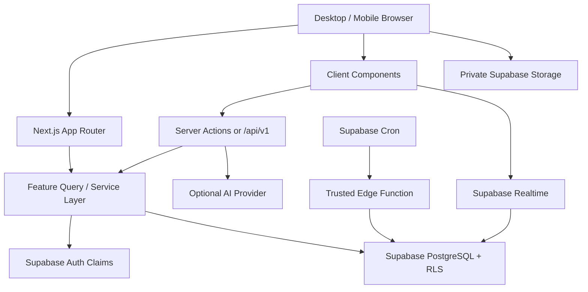
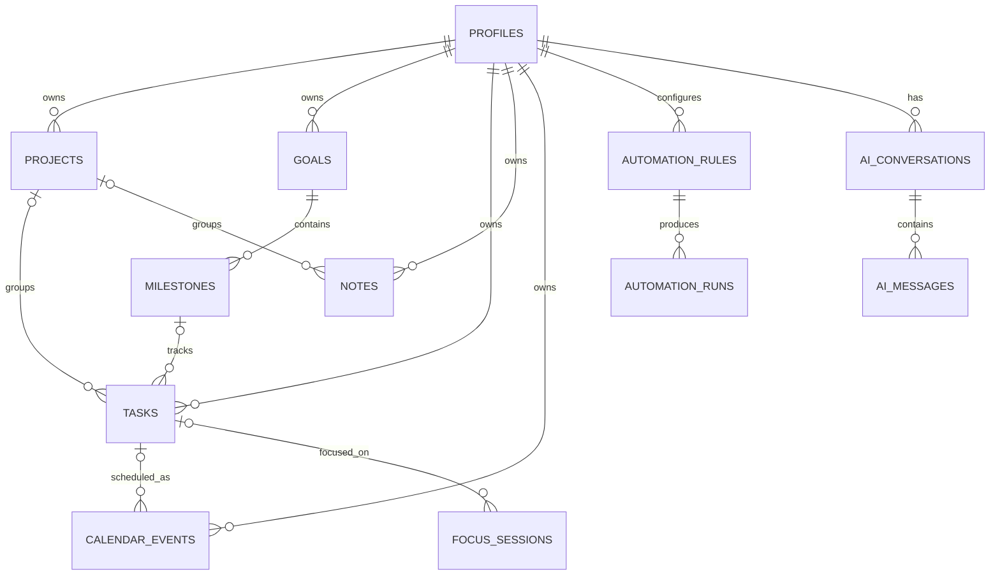

# ORVYN — Full Technical Implementation Architecture

**Edition:** 1.0  
**Prepared:** November 14, 2026  
**Product:** Personal Productivity Operating System  
**Architecture:** Modular monolith / backend-for-frontend  
**Audience:** Full-stack developers and designers

> This document is a build-ready design specification and a starter SQL migration, **not** a claim that the application has already been implemented or deployed. The SQL should be reviewed and run in a test Supabase project before production.

## 1. Product scope and engineering principles

ORVYN combines dashboard widgets, personal tasks, projects, goals, milestone tracking, calendar time-blocking, focus sessions, personal notes, productivity analytics, notifications, and optional AI-assisted planning. A user logs in to a **private single-owner workspace**. Collaboration, subscriptions, external calendar sync, and native mobile applications are deferred.

Principles:

1. **Secure by default:** authenticated identity from verified auth claims, plus database Row Level Security (RLS); no trust in client-supplied owner IDs.
2. **Server-first:** use React Server Components to fetch data; isolate interactive widgets in Client Components.
3. **Feature-based modules:** pages, mutations, and queries are organized around tasks, goals, calendar, and other domains.
4. **One source of truth:** PostgreSQL stores canonical data; temporary UI state stays on the client.
5. **Explicit changes:** AI rescheduling and automation actions never silently modify critical calendar data.
6. **Responsive and accessible:** desktop sidebar, mobile bottom navigation, keyboard support, readable contrast, reduced-motion support.
7. **Incremental delivery:** get a useful authenticated task/dashboard system working before adding AI.

## 2. Technology decisions

| Concern | Selection | Reason |
| --- | --- | --- |
| Web application | Next.js 16+ with App Router | Pages, server components, route handlers, server functions |
| Language | TypeScript, strict mode | Shared types and safer refactoring |
| Styling | Tailwind CSS 4 + CSS variables | Tokens and responsive styling |
| UI primitives | shadcn/ui + Radix UI | Customizable accessible primitives |
| Icons | Lucide React | Coherent icons |
| Animation | Motion for React | Optional subtle animations |
| Forms | React Hook Form + Zod | Client UX and server validation |
| Database | Supabase PostgreSQL | Relational consistency and SQL |
| Auth | Supabase Auth + `@supabase/ssr` | Cookie-based SSR sessions and OAuth support |
| Client data | TanStack Query | Invalidation, cache, optimistic updates |
| Ephemeral UI state | Zustand | Modal state, filters, command palette |
| Visualization | Recharts | Dashboard and analytics charts |
| Rich-text notes | Tiptap (optional) | Structured JSON editor |
| Background scheduling | Supabase Cron + Edge Function | Reminders and safe, predefined automations |
| Hosting | Vercel | Next.js production hosting |
| Tests | Vitest, Testing Library, Playwright, pgTAP | Logic, interaction, E2E, policies |
| Monitoring | Sentry or similar, structured logs | Error diagnosis, opt-in telemetry |

Use the latest compatible **stable** versions, locked with a package lockfile. Supabase's `@supabase/ssr` package is still documented as beta; regression-test updates.

## 3. Runtime architecture



**Request pattern:** browser → Next.js request → verify identity → validate input → domain service → per-user database query → response. A server action and an API route can share the same domain function, avoiding divergent business logic.

**Deployment pattern:** production Next.js on Vercel; Supabase project with separate development/staging/production environments. Host close to the database region to reduce latency.

## 4. Proposed repository structure

```text
orvyn/
├── .env.example
├── .gitignore
├── next.config.ts
├── package.json
├── tsconfig.json
├── components.json
├── eslint.config.mjs
├── vitest.config.ts
├── playwright.config.ts
├── public/
│   ├── icons/
│   └── brand/
├── src/
│   ├── proxy.ts                         # Next.js 16+ session-cookie refresh
│   ├── app/
│   │   ├── layout.tsx                   # Root document/providers/fonts
│   │   ├── globals.css                  # Tokens, light/dark themes
│   │   ├── not-found.tsx
│   │   ├── error.tsx
│   │   ├── loading.tsx
│   │   ├── (marketing)/
│   │   │   └── page.tsx                  # /
│   │   ├── (auth)/
│   │   │   ├── login/page.tsx            # /login
│   │   │   ├── signup/page.tsx           # /signup
│   │   │   ├── forgot-password/page.tsx
│   │   │   └── reset-password/page.tsx
│   │   ├── auth/callback/route.ts       # PKCE OAuth/email callback
│   │   ├── (workspace)/
│   │   │   ├── layout.tsx                # Authenticated app shell
│   │   │   ├── dashboard/page.tsx
│   │   │   ├── tasks/page.tsx
│   │   │   ├── calendar/page.tsx
│   │   │   ├── projects/page.tsx
│   │   │   ├── projects/[projectId]/page.tsx
│   │   │   ├── goals/page.tsx
│   │   │   ├── goals/[goalId]/page.tsx
│   │   │   ├── focus/page.tsx
│   │   │   ├── notes/page.tsx
│   │   │   ├── notes/[noteId]/page.tsx
│   │   │   ├── analytics/page.tsx
│   │   │   ├── assistant/page.tsx
│   │   │   └── settings/page.tsx
│   │   └── api/v1/
│   │       ├── tasks/route.ts
│   │       ├── tasks/[taskId]/route.ts
│   │       ├── projects/route.ts
│   │       ├── projects/[projectId]/route.ts
│   │       ├── goals/route.ts
│   │       ├── goals/[goalId]/route.ts
│   │       ├── goals/[goalId]/milestones/route.ts
│   │       ├── milestones/[milestoneId]/route.ts
│   │       ├── profile/route.ts
│   │       ├── calendar/route.ts
│   │       ├── calendar/[eventId]/route.ts
│   │       ├── focus/route.ts
│   │       ├── focus/[sessionId]/route.ts
│   │       ├── notes/route.ts
│   │       ├── notes/[noteId]/route.ts
│   │       ├── analytics/overview/route.ts
│   │       ├── widgets/route.ts
│   │       ├── notifications/route.ts
│   │       ├── automations/route.ts
│   │       ├── planner/preview/route.ts
│   │       ├── planner/apply/route.ts
│   │       └── assistant/chat/route.ts
│   ├── components/
│   │   ├── ui/                           # shadcn primitives
│   │   ├── shell/                        # AppSidebar, Topbar, MobileNav
│   │   ├── dashboard/                    # StatsCard, WidgetGrid, MomentumChart
│   │   ├── tasks/                        # TaskList, TaskRow, TaskEditor
│   │   ├── calendar/                     # CalendarGrid, TimeBlockEditor
│   │   ├── goals/                        # GoalCard, MilestoneTimeline
│   │   ├── projects/                     # ProjectCard, KanbanBoard
│   │   ├── focus/                        # TimerRing, SessionHistory
│   │   ├── notes/                        # NotesEditor, NoteSidebar
│   │   ├── analytics/                    # StatChart, DateRangePicker
│   │   ├── assistant/                    # AssistantChat, PlanDiff
│   │   └── shared/                       # EmptyState, ConfirmDialog, ErrorView
│   ├── features/
│   │   ├── auth/                         # actions, schemas, hooks
│   │   ├── dashboard/                    # queries and widget configuration
│   │   ├── tasks/                        # actions, services, queries, schemas
│   │   ├── projects/
│   │   ├── goals/
│   │   ├── calendar/
│   │   ├── focus/
│   │   ├── notes/
│   │   ├── analytics/
│   │   ├── automations/
│   │   └── assistant/
│   ├── lib/
│   │   ├── supabase/
│   │   │   ├── browser.ts                # createBrowserClient
│   │   │   ├── server.ts                 # createServerClient
│   │   │   └── proxy.ts                  # updateSession helper
│   │   ├── auth/require-user.ts
│   │   ├── api/respond.ts
│   │   ├── ai/provider.ts
│   │   ├── dates/timezone.ts
│   │   ├── scheduling/availability.ts
│   │   ├── schemas/common.ts
│   │   ├── db.types.ts                   # Supabase generated types
│   │   └── utils.ts
│   ├── hooks/                             # reusable client hooks
│   └── providers/                         # Query, theme, toast
├── supabase/
│   ├── migrations/
│   ├── seed.sql
│   └── tests/                              # SQL/RLS tests
├── tests/
│   ├── unit/
│   ├── integration/
│   └── e2e/
└── .github/workflows/
    └── ci.yml
```

**Routing rule:** route groups in parentheses do not appear in URLs. Keep business logic in `features/*/services.ts`, not directly in page components or route handlers. `src/proxy.ts` belongs alongside `src/app`, not inside `src/app`.

### Responsibilities by file type

- `page.tsx`: renders page and starts data loading; avoids client state unless needed.
- `layout.tsx`: persistent navigation and shell; can redirect unauthenticated sessions, but not replace access checks elsewhere.
- `loading.tsx` and `<Suspense>`: streaming skeletons.
- `route.ts`: HTTP boundary, request parsing, auth, validation, response mapping.
- `actions.ts`: form-triggered mutations called from the Next.js UI; authorization required.
- `queries.ts`: typed reads from Supabase, with a narrow data shape.
- `services.ts`: domain logic (task completion, planner commits, goal progress).
- `schemas.ts`: Zod input schemas shared across API and actions.
- `components/ui`: generic components, no business-specific SQL or Supabase calls.

## 5. Page composition and UI boundaries

| Route | Core components | Server data | Client interactions |
| --- | --- | --- | --- |
| `/dashboard` | `WidgetGrid`, `StatsCard`, `MomentumChart`, `QuickAdd` | Today's tasks, active goals, focus totals | Reorder widgets, complete tasks |
| `/tasks` | `TaskToolbar`, `TaskList`, `TaskEditor` | Paged task list and filters | Filter, create, complete, drag sort |
| `/calendar` | `CalendarHeader`, `CalendarGrid`, `TimeBlockEditor` | Current range of events | Drag, resize, preview conflicts |
| `/projects` | `ProjectGrid`, `KanbanBoard` | Projects and selected task counts | Create project, move task |
| `/goals` | `GoalCard`, `MilestoneTimeline` | Goals, milestone completion | Set milestones and progress |
| `/focus` | `TimerRing`, `SessionHistory` | Recent sessions, active task | Start/pause/finish timer |
| `/notes` | `NotesSidebar`, `NotesEditor` | Note metadata/content | Edit, autosave, search |
| `/analytics` | `MetricsRow`, `TrendChart`, `DateRangePicker` | Time-bounded aggregate metrics | Change range, compare periods |
| `/assistant` | `AssistantChat`, `PlanDiff` | Conversations and allowed context | Ask for plan, approve changes |
| `/settings` | `ProfileForm`, `ThemePicker`, `SecurityPanel` | User profile/preferences | Edit settings, export/delete account |

**Design tokens:** primary background `#080E1C`, surface `#121D33`, elevated surface `#1B2943`, primary accent `#7C9AFF`, violet `#8B5CF6`, cyan `#5EEAD4`, primary text `#F2F5FF`, secondary text `#9CAEC9`. Maintain semantic CSS variables, e.g. `--background`, `--surface`, `--accent`, and `--text-muted`, so alternate themes can be added later.

**Responsive breakpoints:** mobile `< 768px`: single column, bottom navigation; tablet 768–1279px: collapsible sidebar, two columns; desktop ≥1280px: expanded sidebar and responsive dashboard widget grid. Use `prefers-reduced-motion` to disable decorative transitions.

## 6. Data model

Migration: `supabase/migrations/20261114_000001_initial.sql` (included in this bundle). All user-owned tables have `user_id` and ownership policies. The auth user and profile share an `id`.

| Table | Primary fields | Relations and design notes |
| --- | --- | --- |
| `profiles` | `id`, `display_name`, `timezone`, `theme`, `week_starts_on` | `id` → `auth.users.id`; created by signup trigger |
| `projects` | `id`, `user_id`, `name`, `description`, `status`, `color` | Owner workspace for tasks/notes |
| `goals` | `id`, `user_id`, `title`, `target_at`, `status` | Long-term objectives |
| `milestones` | `id`, `user_id`, `goal_id`, `title`, `status`, `sort_order` | A goal has many milestones |
| `tasks` | `id`, `user_id`, `project_id`, `milestone_id`, `status`, `priority`, `due_at`, `estimate_minutes`, `version` | Links projects to milestones; nullable links |
| `calendar_events` | `id`, `user_id`, `task_id`, `starts_at`, `ends_at`, `all_day`, `version` | Time blocks; can optionally represent tasks |
| `focus_sessions` | `id`, `user_id`, `task_id`, `started_at`, `ended_at`, `duration_seconds` | Timed work and break intervals |
| `notes` | `id`, `user_id`, `project_id`, `title`, `content`, `plain_text` | Rich-text JSON plus search text |
| `dashboard_widgets` | `id`, `user_id`, `widget_type`, `config`, `position`, `width` | Per-user dashboard layout |
| `automation_rules` | `id`, `user_id`, `trigger_type`, `conditions`, `actions`, `next_run_at` | Predefined actions only |
| `automation_runs` | `id`, `user_id`, `rule_id`, `status`, `idempotency_key` | Trusted job logs; read-only to client |
| `notifications` | `id`, `user_id`, `kind`, `title`, `read_at` | Trusted server creates; user marks read |
| `activity_events` | `id`, `user_id`, `entity_type`, `entity_id`, `action`, `metadata` | Server-created audit/analytics events |
| `ai_conversations` | `id`, `user_id`, `title` | Optional personal conversations |
| `ai_messages` | `id`, `user_id`, `conversation_id`, `role`, `content` | Server writes role; users read own history |

### Entity relationships



### Data invariants

1. Every user-owned row has a valid owner; parent links also match that owner via **composite foreign keys** `(parent_id, user_id) → parent(id, user_id)`.
2. Task status `done` and `completed_at` must change together. Task completion is atomic.
3. Calendar `ends_at` must be later than `starts_at`; periods are stored in UTC and rendered using the user's IANA timezone.
4. `version` increments on tasks and calendar events for optimistic concurrency. Writes with an outdated version return HTTP 409.
5. Long-term goal progress is *derived* from milestones and/or completed tasks, not a manually maintained percentage.
6. Users archive a project before permanent deletion. Linked records must be removed or reassigned before delete because integrity constraints prevent accidental cascade deletion of tasks.
7. Structured JSON in notes is validated by the app and sanitized when rendered. `automation_rules.actions` is an allowlisted configuration, not code.

### Example safe row-level policy

```sql
alter table public.tasks enable row level security;

create policy tasks_read_self
on public.tasks for select to authenticated
using (user_id = (select auth.uid()));

create policy tasks_insert_self
on public.tasks for insert to authenticated
with check (user_id = (select auth.uid()));
```

A separate `UPDATE` policy has both `USING` and `WITH CHECK`; delete policy uses `USING`. Index all `user_id` ownership columns. Explicit grants and RLS are both required. Never expose `SUPABASE_SECRET_KEY` or legacy service-role keys in browser code.

## 7. Authentication and session management

**Methods:** email/password with confirmation, password reset, optional OAuth (Google or GitHub only if provider setup is enabled), sign-out, and optional MFA in a later phase.

**Flow:**

1. User submits `/signup` or `/login`; inputs validated by Zod.
2. Supabase Auth verifies credentials; its cookie-based SSR client maintains session state.
3. On account creation, database trigger creates a corresponding `profiles` row.
4. The Next.js `src/proxy.ts` refreshes tokens using Supabase SSR's `getClaims()` pattern and propagates updated cookies.
5. Every protected page checks verified claims. Every server action/API route checks identity **again**, independently of the proxy.
6. Feature query/service uses the session-scoped Supabase client; PostgreSQL RLS checks ownership.
7. The PKCE callback `/auth/callback` exchanges the authorization code for a session. Authenticated user is sent to `/dashboard`.
8. On logout, invalidate auth session and clear client-side caches; redirect to `/login`.

**Never trust:** a raw `getSession()` response alone for server authorization; `user_id` in JSON input; browser-hidden controls; a route being private because it is inside `(workspace)`; or a client-accessible service key.

**Account data:** HTTPS, httpOnly cookie management through the SSR helpers, CSRF-safe mutations and origin checks as applicable, short-lived access tokens, Supabase Auth rate-limit settings, private user storage, explicit export/delete flows. If working with a broad audience including minors, use privacy-by-default, minimal data collection, and appropriate consent/age requirements for optional integrations.

## 8. API and service conventions

**Recommended dual boundary:** use Next.js Server Actions for first-party forms and interactions, and `/api/v1` Route Handlers for predictable HTTP endpoints, future integrations, and streaming AI. Both must call the *same* feature service layer. Prefer cursor pagination for large lists; page by time interval for calendar and analytics.

### API contracts

| Method | Path | Input / output | Phase |
| --- | --- | --- | --- |
| `GET` | `/api/v1/tasks` | `status`, `projectId`, `cursor`, `limit` → tasks | 1 |
| `POST` | `/api/v1/tasks` | `{title, projectId?, priority?, dueAt?}` → created task | 1 |
| `PATCH` | `/api/v1/tasks/:taskId` | changes + `expectedVersion` → updated task or 409 | 1 |
| `DELETE` | `/api/v1/tasks/:taskId` | 204; archive preferred in UI | 1 |
| `GET/POST` | `/api/v1/projects` | List/create projects | 1 |
| `PATCH/DELETE` | `/api/v1/projects/:projectId` | Update/delete project after relation checks | 1 |
| `GET/POST` | `/api/v1/goals` | List/create goals | 2 |
| `PATCH/DELETE` | `/api/v1/goals/:goalId` | Update goal | 2 |
| `GET/POST` | `/api/v1/goals/:goalId/milestones` | List/create milestones for a goal | 2 |
| `PATCH/DELETE` | `/api/v1/milestones/:milestoneId` | Update/delete milestone | 2 |
| `GET/PATCH` | `/api/v1/profile` | Get/update user preferences | 1 |
| `GET/POST` | `/api/v1/calendar` | Range query or create event | 2 |
| `PATCH/DELETE` | `/api/v1/calendar/:eventId` | Update event, version check | 2 |
| `GET/POST` | `/api/v1/focus` | List/start focus session | 2 |
| `PATCH` | `/api/v1/focus/:sessionId` | Finish a session; server computes duration | 2 |
| `GET/POST` | `/api/v1/notes` | List/create notes | 2 |
| `GET/PATCH/DELETE` | `/api/v1/notes/:noteId` | Read/edit/remove note | 2 |
| `GET` | `/api/v1/analytics/overview` | Date range → completion/focus stats | 2 |
| `GET/PATCH` | `/api/v1/widgets` | Current layout / save ordering | 2 |
| `GET/PATCH` | `/api/v1/notifications` | Fetch/mark read | 3 |
| `GET/POST` | `/api/v1/automations` | Manage allowlisted automation rules | 3 |
| `POST` | `/api/v1/planner/preview` | Constraints → proposal, **no writes** | 3 |
| `POST` | `/api/v1/planner/apply` | Proposal + expected versions → atomic commit | 3 |
| `POST` | `/api/v1/assistant/chat` | Prompt → streamed assistant answer | 3 |

**Status codes:** 200/201 success, 204 deletion, 400 malformed payload, 401 not authenticated, 403 denied, 404 not found (including hidden unauthorized resources), 409 stale-version conflict, 422 invalid input, 429 throttled, 500 unexpected server problem.

**Standard response:**

```json
{
  "data": {
    "id": "task-uuid",
    "title": "Design portfolio homepage",
    "status": "todo",
    "version": 1
  },
  "meta": { "requestId": "req-uuid" }
}
```

Error:

```json
{
  "error": {
    "code": "VERSION_CONFLICT",
    "message": "This task was updated elsewhere. Refresh and retry."
  },
  "meta": { "requestId": "req-uuid" }
}
```

### Example validation contract (TypeScript)

```ts
import { z } from 'zod'

export const createTaskSchema = z.object({
  title: z.string().trim().min(1).max(240),
  description: z.string().max(20_000).optional(),
  projectId: z.string().uuid().nullable().optional(),
  milestoneId: z.string().uuid().nullable().optional(),
  priority: z.enum(['low', 'medium', 'high', 'urgent']).default('medium'),
  estimateMinutes: z.number().int().min(1).max(1440).nullable().optional(),
  dueAt: z.iso.datetime({ offset: true }).nullable().optional()
})
```

**Illustrative service flow:** `requireUser()` → `createTaskSchema.parse(payload)` → `supabase.from('tasks').insert({ user_id: user.id, ...mappedFields })` → return typed DTO. For updates, filter by both id and `version`; RLS provides final database enforcement. Handle an updated-row count of zero with an authorized lookup to distinguish missing resource from stale version.

## 9. Reusable component library

**Primitives (`components/ui`):** Button, Input, Textarea, Select, Checkbox, Badge, Dialog, Sheet, Dropdown, Tooltip, Toast, Tabs, Skeleton, Card, Avatar, ScrollArea, Progress, Switch, DatePicker.

**Application shell (`components/shell`):**
- `AppSidebar` — 248px desktop navigation and collapse control.
- `Topbar` — page title, global search/command palette, account menu.
- `MobileNav` — fixed Home / Tasks / Create / Calendar / More navigation.
- `WorkspaceLayout` — responsive shell, keyboard and focus management.
- `GlobalCommandPalette` — `Ctrl+K` / `⌘K` for search and actions.

**Domain components:**
- Dashboard: `StatCard`, `WidgetGrid`, `WeeklyMomentum`, `UpcomingEvents`.
- Tasks: `TaskRow`, `TaskList`, `TaskFilters`, `TaskEditor`, `PriorityBadge`.
- Calendar: `CalendarGrid`, `EventCard`, `TimeBlockEditor`, `ConflictDialog`.
- Projects: `ProjectCard`, `KanbanBoard`, `ProjectProgress`.
- Goals: `GoalCard`, `MilestoneTimeline`, `GoalProgressRing`.
- Focus: `TimerRing`, `SessionControls`, `FocusHistory`.
- Notes: `NotesSidebar`, `RichTextEditor`, `AutosaveIndicator`.
- Analytics: `MetricTile`, `TrendChart`, `ReportFilters`.
- AI: `AssistantChat`, `PlanProposal`, `PlanDiff`, `ApplyPlanButton`.

**Component interface convention:** stateless presentational components accept typed props and callbacks; data-fetching lives in a page/container or dedicated hook. Use loading/empty/error states on every data view; avoid chart-only color cues and support keyboard interactions.

## 10. Application state and realtime

State categories:

- **PostgreSQL:** canonical tasks, notes, goals, events, widgets, profile.
- **RSC data:** authenticated first render of pages, preferably scoped to user and not publicly cached.
- **TanStack Query:** paginated client collections, invalidation, optimistic task edits.
- **Zustand:** open modal, current UI filters, mobile drawer, temporary panel state.
- **URL query parameters:** shareable filters, calendar view/date, analytics range.

Enable Supabase Realtime **only for needed tables**, initially `tasks`, `calendar_events`, and `notifications`. Filter subscriptions to the authenticated user's data and keep RLS enabled. On change, invalidate the affected TanStack Query key rather than merging untrusted event payloads into all caches. Implement conflict/rollback behavior for optimistic updates.

## 11. Adaptive planner and AI contracts

**Planner input:** selected tasks and estimates; available work windows; time zone; calendar conflicts; priorities; deadlines; optional buffer/minimum-break rules.

**Deterministic baseline algorithm:**

1. Normalize all times to UTC internally and derive local working windows from the profile timezone.
2. Load calendar events and subtract busy intervals from work windows.
3. Rank unscheduled tasks by deadline, priority, dependencies (if added later), and user choice.
4. Fit tasks into free intervals with realistic buffers. Flag tasks that cannot fit.
5. Return a **preview** of calendar changes and conflicts without saving.
6. On user confirmation, re-check versions and apply changes atomically in a database transaction/RPC.

AI's first role is to **suggest**, not decide: summarize plans, propose milestones, explain tradeoffs, and produce structured output validated by Zod. Only send the minimum relevant task/calendar information to the AI service when users opt in; never send hidden secrets or unrelated note content. Rate-limit AI endpoints and cap token usage to control cost. Treat AI output as untrusted and require confirmation for data mutations.

## 12. Notifications and automations

- Use a small set of predefined rules: `scheduled`, `task_completed`, `task_overdue`, `weekly_review`.
- A trusted Cron-driven Edge Function scans due rules and executes allowlisted actions.
- Store `automation_runs` with `(rule_id, idempotency_key)` uniqueness so retries do not duplicate work.
- Write notifications from trusted server processes; clients can read and mark them as read, but cannot forge notifications.
- Observe job success, failure, retry attempts, and execution time. Use secure server-side secrets for scheduled worker calls.

**Privacy:** Avoid intrusive push notifications by default. Allow users to disable reminders and set quiet hours.

## 13. Analytics design

Calculate time-bounded aggregates from canonical records:

| Metric | Definition |
| --- | --- |
| Tasks completed | Count of tasks whose `completed_at` falls inside interval |
| Completion ratio | Completed scheduled tasks divided by tasks due in period; label denominator clearly |
| Focus time | Sum of finished focus session durations in interval |
| Goal progress | Completed milestones / total milestones (or clearly defined task method) |
| Planned vs actual | Estimated task minutes compared with logged focus time, labeled approximation |
| Weekly momentum | Daily task completions + focus sessions; separate units/charts |

Do not invent percentages for goals with no milestones; show `Not started` or prompt setup. Use user's timezone for daily boundaries. Aggregate server-side; avoid sending all raw events for large date ranges.

## 14. Security controls and failure modes

| Risk | Mitigation |
| --- | --- |
| User A reads User B's task | RLS, session-derived ownership, cross-owner integration tests |
| Linked record belongs to another user | Composite owner foreign keys |
| Route is public despite private UI | Verify identity in every route/action/service |
| AI edits schedule without approval | Preview/apply split and diff confirmation |
| Double calendar modification | Optimistic `version` and transactional apply |
| API abuse | IP/user rate limits, payload bounds, pagination |
| Leaked service secret | Environment-only, no `NEXT_PUBLIC_` prefix, isolated trusted workers |
| Rich-text injection | Structured editor JSON, output sanitization, CSP |
| Unbounded queries | Indexed ownership/time columns, bounded limits |
| Slow subscriptions | Subscribe to only necessary tables; invalidate scoped cache |
| Broken signups | Test `auth.users` → `profiles` trigger in staging |
| Lost data | Supabase database backup/PITR plan based on service tier and recovery tests |

**Security verification:** test unauthenticated access; cross-account reads/inserts/updates/deletes; cross-user foreign-key attempts; expired sessions; account deletion; reset-token flows; automation permissions; AI request throttling.

## 15. CI/CD and environments

- `development`: local Next.js and local Supabase project via Supabase CLI, seeded demo accounts.
- `staging`: Vercel preview + separate Supabase project; run migrations and integration/E2E tests.
- `production`: production Vercel deployment + production Supabase project; scheduled backups and monitoring.

**Pipeline:** lint → TypeScript check → unit tests → SQL policy tests → build → Playwright smoke tests → gated migration/deploy. Review migration diffs; apply production migrations under a controlled process with rollback plan. Never run unreviewed destructive migrations automatically on production data.

Suggested local commands:

```bash
npx create-next-app@latest orvyn --typescript --tailwind --eslint --app --src-dir
cd orvyn
npm install @supabase/supabase-js @supabase/ssr zod react-hook-form @hookform/resolvers @tanstack/react-query zustand recharts lucide-react motion
npm install -D vitest @testing-library/react @testing-library/jest-dom @playwright/test
npx supabase init
# Configure .env.local, link your development Supabase project, then apply reviewed migrations.
npm run dev
```

Suggested `.env.example`:

```dotenv
NEXT_PUBLIC_SUPABASE_URL=https://your-project.supabase.co
NEXT_PUBLIC_SUPABASE_PUBLISHABLE_KEY=your-public-key
NEXT_PUBLIC_APP_URL=http://localhost:3000
# Only if a trusted server worker requires administrative access:
SUPABASE_SECRET_KEY=server-only-secret
# Optional AI provider:
AI_API_KEY=server-only-ai-key
```

Do not commit `.env.local` or real credentials. The public/publishable key is designed for frontend use **only when RLS and grants are correctly secured**.

## 16. Development milestones and acceptance criteria

| Milestone | Estimated effort* | Key deliverables | Acceptance criteria |
| --- | --- | --- | --- |
| M0 — Foundation | 2–4 days | Repo, UI tokens, shared shell, CI, Supabase project | Runs locally, passes lint/typecheck/build, responsive shell |
| M1 — Authentication | 3–5 days | Signup/login/reset, profile trigger, auth guards, RLS | Private routes redirect and cross-user database tests pass |
| M2 — Tasks & projects | 5–8 days | Task CRUD, priority/filtering, projects, status mutations | Full persistence, optimistic update rollback, validation |
| M3 — Dashboard | 4–6 days | Live task summary, widgets, goals snapshot, quick-add | User-specific data, loading/empty/error states |
| M4 — Calendar, goals & focus | 7–12 days | Events, time blocks, milestones, timer, session log | All timezones respected; drag edits detect stale versions |
| M5 — Notes & analytics | 5–8 days | Note editor, search, charts, date filters | Autosave reliable; metric definitions tested |
| M6 — Smart planning & AI | 7–12 days | Preview/apply planner, chat, Zod AI outputs | No silent AI writes; conflicts visible; rate limits |
| M7 — Automations & notifications | 4–7 days | Cron jobs, idempotency, reminder center | No duplicate deliveries; jobs observable |
| M8 — Launch quality | 5–8 days | E2E tests, accessibility, backups, audit, deploy | Critical flows tested and production monitoring active |

*Effort estimates are **developer workdays**, not guaranteed elapsed delivery time. They assume one experienced developer with a defined scope; integrations, design review, and QA can change them substantially.

### MVP definition (M0–M3)

A user can create an account, log in, create/edit/complete tasks, organize tasks into projects, see a customized dashboard, and retain all changes after refresh. The site works on desktop and mobile, is keyboard accessible, and prevents cross-user access. All other capabilities can be added in controlled stages.

## 17. Implementation order and immediate next tasks

1. Initialize Next.js/TypeScript/Tailwind; implement design tokens, fonts, navigation, and responsive shell.
2. Configure Supabase SSR browser/server clients and `src/proxy.ts`; implement signup/login/password reset.
3. Review and apply `20261114_000001_initial.sql` on a **development** Supabase project.
4. Generate TypeScript DB types using Supabase CLI; write RLS tests with two different user identities.
5. Build feature service, Zod contract, and UI for projects/tasks.
6. Add test fixtures and dashboard queries; implement global quick-add and widgets.
7. Proceed through M4–M8 only when the previous milestone's acceptance checks pass.

## 18. Reference documentation

- [Next.js App Router](https://nextjs.org/docs/app)
- [Next.js Proxy file convention](https://nextjs.org/docs/app/api-reference/file-conventions/proxy)
- [Next.js authorization guidance](https://nextjs.org/docs/app/guides/authentication)
- [Supabase Next.js Auth quickstart](https://supabase.com/docs/guides/auth/quickstarts/nextjs)
- [Supabase SSR client setup](https://supabase.com/docs/guides/auth/server-side/creating-a-client?framework=nextjs)
- [Supabase Row Level Security](https://supabase.com/docs/guides/database/postgres/row-level-security)
- [Supabase Auth user management](https://supabase.com/docs/guides/auth/managing-user-data)
- [Supabase Cron](https://supabase.com/docs/guides/cron)

---

**Architecture decision:** Build ORVYN as a well-separated Next.js modular monolith with Supabase and strict per-user RLS; deliver a usable tasks/dashboard MVP, then layer in planning, notes, focus, analytics, and opt-in AI-assisted scheduling.
